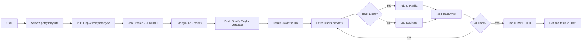

# Playlist Library Specifications

**Version:** 0.2.0  
**Status:** Draft  
**Author:** Junie  
**Last Updated:** 2026-11-04  
**Service:** music-service  

---

## 1. Overview

### 1.1 Purpose
This document defines the technical specifications for implementing a **Playlist Import** feature in the Music Service. The feature enables users to import playlists directly from their Spotify account, including metadata and tracks.

### 1.2 Scope
- **Playlist Import**: Import playlists from Spotify to Music Service
- **Track Synchronization**: Sync tracks from Spotify playlists
- **Metadata Import**: Capture playlist name, description, cover image
- **Async Processing**: Background sync with job ID and status polling
- **No Duplicate Tracks**: Log duplicates but allow them (for now)

### 1.3 Key Features
1. **Playlist Import**: User selects Spotify playlists to import
2. **Track Sync**: Fetch top 10 tracks per artist from Spotify
3. **Metadata Capture**: Import playlist name, description, cover image
4. **Async Processing**: Job ID + polling pattern for sync
5. **Duplicate Logging**: Log duplicate tracks but don't prevent them
6. **Partial Results**: Save partial sync results on errors

## 2. Domain Model

### 2.1 Entities

#### 2.1.1 Playlist
```kotlin
@Entity
@Table(name = "playlist")
data class Playlist(
    @Column(nullable = false)
    val name: String,
    
    @Column(length = 2000)
    val description: String?,
    
    @Column(length = 1000)
    val coverImageUrl: String?,
    
    @Column(name = "created_by", nullable = false)
    @ManyToOne(fetch = FetchType.LAZY)
    @JoinColumn(name = "created_by", nullable = false)
    val createdBy: User?,
    
    @CreationTimestamp
    @Column(name = "created", nullable = false)
    val created: LocalDateTime? = null,
    
    @UpdateTimestamp
    @Column(name = "updated", nullable = false)
    val updated: LocalDateTime? = null,
    
    @Id
    @GeneratedValue(strategy = GenerationType.UUID)
    val id: UUID? = null
)
```
> **Note:** `is_public` field is removed - all playlists are private.

#### 2.1.2 PlaylistTrack
```kotlin
@Entity
@Table(name = "playlist_track")
data class PlaylistTrack(
    @Column(name = "playlist_id", nullable = false)
    @ManyToOne(fetch = FetchType.LAZY)
    @JoinColumn(name = "playlist_id", nullable = false)
    val playlist: Playlist?,
    
    @Column(name = "track_id", nullable = false)
    @ManyToOne(fetch = FetchType.LAZY)
    @JoinColumn(name = "track_id", nullable = false)
    val track: Track?,
    
    @Column(nullable = false)
    val position: Int = 0,
    
    @CreationTimestamp
    @Column(name = "created", nullable = false)
    val created: LocalDateTime? = null,
    
    @Id
    @GeneratedValue(strategy = GenerationType.UUID)
    val id: UUID? = null
)
```

#### 2.1.3 PlaylistSyncJob
```kotlin
@Entity
@Table(name = "playlist_sync_job")
data class PlaylistSyncJob(
    @Column(name = "playlist_id", nullable = false)
    @ManyToOne(fetch = FetchType.LAZY)
    @JoinColumn(name = "playlist_id", nullable = false)
    val playlist: Playlist?,
    
    @Column(name = "spotify_playlist_id", nullable = false)
    val spotifyPlaylistId: String,
    
    @Column(nullable = false)
    val status: SyncJobStatus, // PENDING, RUNNING, COMPLETED, FAILED
    
    @Column(name = "started_at", nullable = false)
    val startedAt: Instant? = null,
    
    @Column(name = "completed_at")
    val completedAt: Instant? = null,
    
    @Column(name = "track_count")
    val trackCount: Int? = null,
    
    @Column(name = "error_message")
    val errorMessage: String?,
    
    @CreationTimestamp
    @Column(name = "created", nullable = false)
    val created: Instant? = null,
    
    @Id
    @GeneratedValue(strategy = GenerationType.UUID)
    val id: UUID? = null
)

enum class SyncJobStatus {
    PENDING,
    RUNNING,
    COMPLETED,
    FAILED
}
```

### 2.2 Relationships
- **Playlist** ↔ **PlaylistTrack** (1:N): One playlist contains many tracks
- **Playlist** ↔ **PlaylistSyncJob** (1:1): Each playlist has one current sync job (or none)
- **Playlist** ↔ **User** (1:1): Each playlist has one creator
- **PlaylistTrack** ↔ **Track** (1:1): Each playlist track references one track entity
- **PlaylistSyncJob** ↔ **SpotifyPlaylist** (1:1): Job references Spotify playlist ID

---

## 3. API Specification

### 3.1 REST Endpoints

#### 3.1.1 Playlist Import

| Method | Endpoint | Description | Auth Required |
|--------|----------|-------------|---------------|
| `POST` | `/api/v1/playlists/sync` | Import Spotify playlists (async) | ✅ |
| `GET` | `/api/v1/playlists/sync/{jobId}` | Get sync job status | ✅ |

#### 3.1.2 Playlist Management

| Method | Endpoint | Description | Auth Required |
|--------|----------|-------------|---------------|
| `POST` | `/api/v1/playlists` | Create a new playlist (manual) | ✅ |
| `GET` | `/api/v1/playlists` | List all playlists for current user | ✅ |
| `GET` | `/api/v1/playlists/{id}` | Get playlist details with tracks | ✅ |
| `PUT` | `/api/v1/playlists/{id}` | Update playlist metadata | ✅ |
| `DELETE` | `/api/v1/playlists/{id}` | Delete playlist | ✅ |

#### 3.1.3 Track Management

| Method | Endpoint | Description | Auth Required |
|--------|----------|-------------|---------------|
| `POST` | `/api/v1/playlists/{id}/tracks` | Add track to playlist | ✅ |
| `PUT` | `/api/v1/playlists/{id}/tracks` | Update track position | ✅ |
| `DELETE` | `/api/v1/playlists/{id}/tracks/{trackId}` | Remove track from playlist | ✅ |
| `GET` | `/api/v1/playlists/{id}/tracks` | Get tracks in playlist | ✅ |

### 3.2 Request/Response Models

#### 3.2.1 Import Spotify Playlists (Async)

**Request Body:**
```json
{
  "spotifyPlaylistIds": [
    "37i9dQZF1DXcBWIGoYBM5M",
    "37i9dQZF1DX0XUsuxWHRQd",
    "4uVU6U7yqEjeTn0DRd5d3B"
  ],
  "syncOptions": {
    "maxTracksPerArtist": 10,
    "includeMetadata": true
  }
}
```

**Response (202 Accepted):**
```json
{
  "jobId": "uuid-string",
  "status": "PENDING",
  "startedAt": "2026-11-04T18:16:00Z",
  "estimatedCompletionMs": 30000
}
```

#### 3.2.2 Get Sync Job Status

**Response (200 OK):**
```json
{
  "jobId": "uuid-string",
  "status": "COMPLETED",
  "startedAt": "2026-11-04T18:16:00Z",
  "completedAt": "2026-11-04T18:16:30Z",
  "playlistId": "uuid-string",
  "playlistName": "My Favorite Songs",
  "trackCount": 142,
  "successCount": 142,
  "duplicateCount": 5,
  "errorCount": 0,
  "errors": []
}
```

**Response (200 OK) - Failed:**
```json
{
  "jobId": "uuid-string",
  "status": "FAILED",
  "startedAt": "2026-11-04T18:16:00Z",
  "completedAt": "2026-11-04T18:16:15Z",
  "playlistId": "uuid-string",
  "playlistName": "My Favorite Songs",
  "trackCount": 50,
  "successCount": 50,
  "duplicateCount": 0,
  "errorCount": 1,
  "errorMessage": "Spotify API rate limit exceeded",
  "errors": [
    {
      "track": "Song by Artist",
      "error": "Track not found in database"
    }
  ]
}
```

#### 3.2.3 Create Playlist (Manual)

**Request Body:**
```json
{
  "name": "My Favorites",
  "description": "My favorite tracks",
  "coverImageUrl": "https://example.com/cover.jpg"
}
```

**Response (201 Created):**
```json
{
  "id": "uuid-string",
  "name": "My Favorites",
  "description": "My favorite tracks",
  "trackCount": 0,
  "createdAt": "2026-11-04T18:16:00Z",
  "updatedAt": "2026-11-04T18:16:00Z"
}
```

#### 3.2.4 Add Track to Playlist

**Request Body:**
```json
{
  "trackId": "uuid-string",
  "position": 0
}
```

**Response (201 Created):**
```json
{
  "id": "uuid-string",
  "playlistId": "uuid-string",
  "trackId": "uuid-string",
  "position": 0,
  "createdAt": "2026-11-04T18:16:00Z"
}
```

### 3.3 Error Responses

| Status Code | Error Code | Description |
|-------------|------------|-------------|
| `400` | `INVALID_INPUT` | Invalid request parameters |
| `401` | `UNAUTHORIZED` | Authentication required |
| `403` | `FORBIDDEN` | Insufficient permissions |
| `404` | `NOT_FOUND` | Resource not found |
| `409` | `CONFLICT` | Playlist already exists / Duplicate sync |
| `422` | `VALIDATION_ERROR` | Validation failed |
| `500` | `INTERNAL_ERROR` | Server error |

---

## 4. Spotify Playlist Import Feature

### 4.1 Feature Description
The Spotify Playlist Import feature allows users to import playlists directly from their Spotify account. When importing, the system fetches metadata (name, description, cover image) and tracks (top 10 per artist) from Spotify.

### 4.2 User Flow



### 4.3 Implementation Details

#### 4.3.1 Spotify API Integration
The service uses the following Spotify API endpoints:

| Endpoint | Purpose | Rate Limit |
|----------|---------|------------|
| `GET /v1/playlists/{id}` | Get playlist metadata (name, description, image) | 6/min |
| `GET /v1/playlists/{id}/tracks` | Get playlist tracks | 6/min |
| `GET /v1/artists/{id}/top-tracks` | Get artist's top tracks | 180/min |

#### 4.3.2 Sync Process (Async)
1. **Request Processing**:
   - Validate user has active Spotify OAuth2 token
   - Receive list of Spotify playlist IDs
   - Create `PlaylistSyncJob` with status `PENDING`
   
2. **Background Processing** (executed in background thread/job queue):
   - Update job status to `RUNNING`
   - For each Spotify playlist ID:
     a. Fetch playlist metadata (name, description, cover image)
     b. Create `Playlist` entity in database
     c. Fetch tracks from Spotify playlist
     d. For each track:
        - Fetch top 10 tracks per artist (if not already in playlist)
        - Check if track exists in database
        - If exists: Add to playlist with original position
        - If not exists: Log duplicate, skip
     e. Save playlist with tracks to database
   - Update job status to `COMPLETED` or `FAILED`

3. **Response Handling**:
   - Return job ID and initial status to frontend
   - Frontend polls `/api/v1/playlists/sync/{jobId}` for status

#### 4.3.3 Duplicate Handling
- If track already exists in playlist: **Log warning, continue processing**
- Track position is preserved from Spotify
- Duplicate count is tracked in job status

#### 4.3.4 Rate Limiting Strategy
- Implement exponential backoff for Spotify API calls
- Batch playlist metadata requests
- Cache playlist data with 24-hour TTL
- Progress indicators during sync

### 4.4 Data Flow

```
User Request
    ↓
SpotifyOAuthService (validate token)
    ↓
Spotify API (playlist metadata + tracks)
    ↓
MusicBrainz/Musixmatch (track enrichment)
    ↓
PlaylistSyncJob (background processing)
    ↓
Database (save playlist + tracks)
```

### 4.5 Partial Results on Error
- If Spotify API fails mid-sync: **Save partial results**
- Log error message
- Job status set to `FAILED` with `errorMessage`
- Frontend receives partial sync results

---

## 5. Security Considerations

### 5.1 Authentication & Authorization
- All playlist operations require valid JWT token
- Users can only access their own playlists
- Admin users can manage all playlists (for support purposes)
- Sync operations validate Spotify OAuth2 token freshness

### 5.2 Spotify OAuth2
- OAuth2 credentials stored encrypted in `SpotifyOAuthCredentials` table
- Access tokens refreshed automatically before expiry
- Token refresh happens in background thread
- Validate token permissions before sync operations
- Never store raw Spotify tokens in logs

### 5.3 Sensitive Data
- Never log Spotify tokens, user IDs, or playlist IDs
- Sanitize artist/track names for search indexing
- Encrypt cover image URLs if external storage used

### 5.4 Privacy
- All playlists are **private only** (no public toggle)
- Playlists are never exposed in public endpoints
- No sharing links (future feature not yet implemented)
- Playlist data stored in same database as music data

---

## 6. Performance Requirements

### 6.1 Response Times
| Operation | P95 Latency | P99 Latency |
|-----------|-------------|-------------|
| Create playlist (manual) | < 100ms | < 200ms |
| Get playlist | < 50ms | < 100ms |
| Add track | < 150ms | < 300ms |
| Sync playlists (job creation) | < 200ms | < 500ms |
| Get sync job status | < 50ms | < 100ms |
| List tracks in playlist | < 200ms | < 500ms |

### 6.2 Database Indexes
```sql
CREATE INDEX idx_playlist_created_by ON playlist(created_by);
CREATE INDEX idx_playlist_track_playlist ON playlist_track(playlist_id);
CREATE INDEX idx_playlist_track_track ON playlist_track(track_id);
CREATE INDEX idx_playlist_sync_job_status ON playlist_sync_job(status);
CREATE INDEX idx_playlist_sync_job_playlist ON playlist_sync_job(playlist_id);
```

### 6.3 Caching Strategy
- Playlist metadata cached with 5-minute TTL
- Track data cached with 1-hour TTL
- Spotify playlist data cached with 24-hour TTL
- Cache invalidation on playlist updates
- Background sync jobs use separate cache to avoid contention

### 6.4 Async Processing
- Sync jobs processed in background thread pool
- Maximum concurrent sync jobs per user: 1
- Estimated completion time: 30-60 seconds for 10 playlists
- Progress can be polled via GET `/api/v1/playlists/sync/{jobId}`

---

## 7. Database Schema

### 7.1 Migration Script Outline

```sql
-- Table: playlist
-- Stores user playlists (all private)
CREATE TABLE playlist (
    id UUID PRIMARY KEY DEFAULT gen_random_uuid(),
    name VARCHAR(255) NOT NULL,
    description TEXT,
    cover_image_url VARCHAR(1000),
    created_by UUID NOT NULL REFERENCES user(id),
    created TIMESTAMP WITH TIME ZONE DEFAULT CURRENT_TIMESTAMP,
    updated TIMESTAMP WITH TIME ZONE DEFAULT CURRENT_TIMESTAMP,
    CONSTRAINT uk_playlist_created_by UNIQUE (created_by)
);

-- Table: playlist_track
-- Links tracks to playlists with position tracking
CREATE TABLE playlist_track (
    id UUID PRIMARY KEY DEFAULT gen_random_uuid(),
    playlist_id UUID NOT NULL REFERENCES playlist(id),
    track_id UUID NOT NULL REFERENCES track(id),
    position INTEGER NOT NULL DEFAULT 0,
    created TIMESTAMP WITH TIME ZONE DEFAULT CURRENT_TIMESTAMP,
    UNIQUE (playlist_id, track_id)
);

-- Table: playlist_sync_job
-- Tracks async sync operations from Spotify
CREATE TABLE playlist_sync_job (
    id UUID PRIMARY KEY DEFAULT gen_random_uuid(),
    playlist_id UUID NOT NULL REFERENCES playlist(id),
    spotify_playlist_id VARCHAR(255) NOT NULL,
    status VARCHAR(50) NOT NULL DEFAULT 'PENDING',
    started_at TIMESTAMP WITH TIME ZONE NOT NULL,
    completed_at TIMESTAMP WITH TIME ZONE,
    track_count INTEGER,
    error_message TEXT,
    created TIMESTAMP WITH TIME ZONE DEFAULT CURRENT_TIMESTAMP,
    CONSTRAINT uk_sync_job_spotify UNIQUE (spotify_playlist_id)
);

-- Enum for sync job status (stored as VARCHAR in database)
CREATE TYPE sync_job_status AS ENUM ('PENDING', 'RUNNING', 'COMPLETED', 'FAILED');
ALTER TABLE playlist_sync_job ALTER COLUMN status TYPE sync_job_status USING status::text;
```

---

## 8. Future Enhancements

### 8.1 Planned Features
- [ ] Playlist sharing (generate shareable links)
- [ ] Collaborative playlists (multiple users can add tracks)
- [ ] Playlist templates (pre-defined track collections)
- [ ] Smart playlists (auto-add tracks based on rules)
- [ ] Playlist recommendations (AI-based suggestions)
- [ ] Playlist analytics (most played tracks, etc.)
- [ ] Export playlists (JSON/Spotify format)
- [ ] Scheduled sync (auto-sync at specific times)
- [ ] Duplicate prevention (configurable behavior)

### 8.2 Technical Debt
- Implement async processing for large sync operations (job queue)
- Add pagination for playlist track lists
- Implement soft deletes for playlists
- Add audit logging for playlist modifications
- Improve error handling for Spotify API rate limits
- Add retry logic for failed sync jobs
- Add progress callbacks for large playlists

---

## 9. Testing Strategy

### 9.1 Unit Tests
- Playlist CRUD operations
- Track position management
- Spotify OAuth2 token validation
- Sync job status transitions
- Duplicate logging logic

### 9.2 Integration Tests
- Full playlist import workflow
- Spotify API integration (metadata + tracks)
- Database constraint validation
- Permission checks
- Async job completion verification

### 9.3 Load Tests
- Concurrent playlist imports
- Large playlist sync (100+ tracks)
- Track addition under load
- Multiple playlist imports simultaneously

### 9.4 Error Scenarios
- Spotify API rate limiting
- Failed track lookups
- Mid-sync failures
- Partial result saving

---

## 10. Dependencies

### 10.1 External Services
- **Spotify API**: 
  - Playlist metadata (name, description, cover image)
  - Playlist tracks
  - Artist top tracks (for enrichment)
  - OAuth2 authentication
- **MusicBrainz**: Track metadata enrichment (optional)
- **Musixmatch**: Track metadata enrichment (optional)

### 10.2 Internal Services
- **Authentication Service**: User authentication & JWT validation
- **Usermanagement Service**: User data integration

### 10.3 Libraries/Technologies
- **Spring Boot**: Async processing support
- **Spring Task**: Background job execution
- **Hibernate**: JPA entity management
- **Flyway**: Database migrations

---

## 11. Glossary

| Term | Definition |
|------|------------|
| **Playlist** | User-created collection of music tracks (all private) |
| **Import** | Process of fetching playlist data from Spotify to Music Service |
| **Sync** | Background process of updating playlist data |
| **Sync Job** | Async operation with status tracking (PENDING, RUNNING, COMPLETED, FAILED) |
| **OAuth2** | Authorization framework for secure Spotify API access |
| **ISRC** | International Standard Recording Code (unique track identifier) |
| **TTL** | Time-To-Live for cache entries |

---

## 12. Revision History

| Version | Date | Author | Changes |
|---------|------|--------|---------|
| 0.2.0 | 2026-11-04 | Junie | Updated to reflect final requirements: async sync, private-only playlists, duplicate logging |
| 0.1.0 | 2026-11-04 | Junie | Initial draft with artist sync feature (superseded) |

---

*This document is a living specification and will be updated as the feature develops.*
